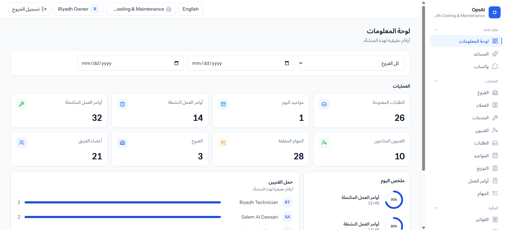

# OpsAI

Multi-tenant operations platform for field-service and maintenance companies: from the first customer message to the final invoice.



## What it does

- **Multi-tenancy:** every organization has its own branches, team, customers, operations and finances. Policies and role checks enforce company isolation.
- **Operations:** customers, service catalog, technicians and skills, service requests, appointments with overlap detection, work orders, tasks, activity log.
- **Dispatch board:** day timeline per technician, unassigned jobs list, assignment drawer, drag to reschedule through the existing appointment update (so the overlap check still decides), and a rules-based "Best match" suggestion (skill, then utilization, then earliest free slot).
- **Finance:** invoices with sequential numbers, full and partial payments, refunds, overdue handling, finance KPIs.
- **Assistant:** reads live data through application tools and can create requests, tasks and appointments only after the user confirms. It has no financial tools by design (no payments, refunds or discounts).
- **WhatsApp:** Meta Cloud API provider with signed-webhook verification, per-organization customer matching, encrypted integration settings, an inbox, and hand-off to a human agent.
- **Roles:** owner, admin, manager, dispatcher, technician, accountant, customer service.
- **Languages:** Arabic (RTL) and English.

## Status

Working demo. Backend and UI are covered by automated tests, but two integrations have only been tested with fake providers so far:

| Area | Status |
| --- | --- |
| Operations, dispatch, finance | Implemented and tested locally |
| Assistant with the fake provider | Implemented and tested |
| Assistant with the live OpenAI API | Not verified yet |
| WhatsApp with the fake provider | Implemented and tested |
| WhatsApp with a live Meta account | Not verified yet |
| MySQL in production, deployment, backups | Not done |
| Invoice PDF, card payment gateways, Saudi e-invoicing | Not implemented |
| Subscriptions and SaaS plans | Not implemented |

## Stack

- Laravel 12, PHP 8.2, session authentication, Laravel Sanctum
- React, TypeScript, Inertia.js, Tailwind CSS, Vite
- Pest for backend tests, Playwright for end-to-end tests
- SQLite for local development and tests. MySQL is the intended production database and is configured in `config/database.php`

## Setup

```bash
composer install
npm install
cp .env.example .env
php artisan key:generate
php artisan migrate --seed
npm run dev
php artisan serve
```

Or run `composer run dev` to start the app server, queue listener, logs and Vite together. Redis is optional: the default local queue and cache drivers are `database`.

### Richer demo data

`php artisan db:seed --class=Database\\Seeders\\DemoDataSeeder` rewrites the demo company's operational data (dates are relative to the day it runs). It deletes and recreates that company's demo rows, so back up your database file first. Never run `migrate:fresh` on a database you want to keep.

## Demo accounts

Created by the seeders. The password for every demo user is `password`. Use them in development only.

| Email | Organization | Role |
| --- | --- | --- |
| owner@riyadh-cooling.test | Riyadh Cooling & Maintenance | owner |
| admin@riyadh-cooling.test | Riyadh Cooling & Maintenance | admin |
| manager@riyadh-cooling.test | Riyadh Cooling & Maintenance | manager |
| dispatcher@riyadh-cooling.test | Riyadh Cooling & Maintenance | dispatcher |
| technician@riyadh-cooling.test | Riyadh Cooling & Maintenance | technician |
| accountant@riyadh-cooling.test | Riyadh Cooling & Maintenance | accountant |
| support@riyadh-cooling.test | Riyadh Cooling & Maintenance | customer service |
|
